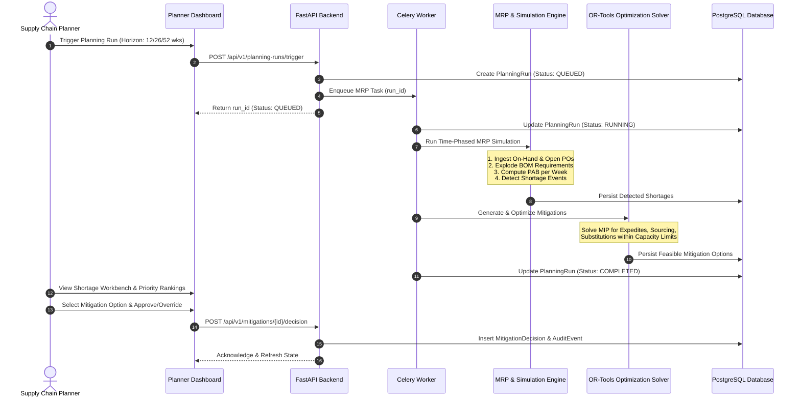
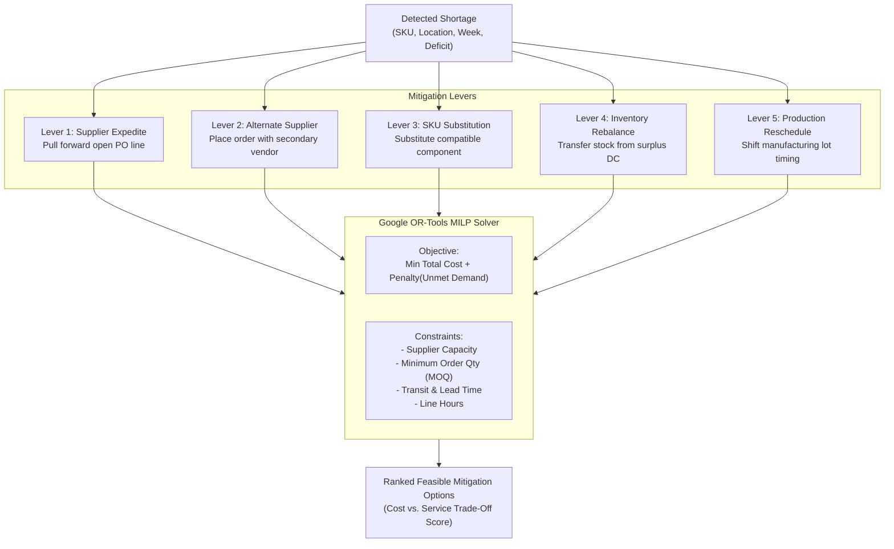
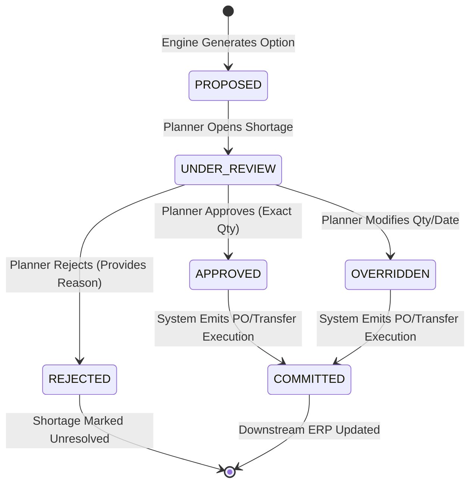

# SupplyChain IQ - Business Workflow & Planning Logic

## 1. End-to-End Planning Lifecycle

The complete supply chain planning cycle runs in a structured pipeline of deterministic stages:

---

## 2. Core Supply Chain Mathematical Formulations

### 2.1 Time Bucketing & Planning Horizon
- The planning horizon is divided into discrete weekly buckets: $t \in \{1, 2, \dots, H\}$, where $H \in \{12, 26, 52\}$.
- Week 1 begins at the planning snapshot date $T_0$.

### 2.2 Projected Available Balance (PAB) Calculation
For each SKU $i$ at Location $j$ in week $t$:

$$\text{PAB}_{i,j,t} = \begin{cases} 
\text{OH}_{i,j} + \text{SR}_{i,j,1} + \text{PP}_{i,j,1} - \text{GR}_{i,j,1} & \text{for } t = 1 \\
\text{PAB}_{i,j,t-1} + \text{SR}_{i,j,t} + \text{PP}_{i,j,t} - \text{GR}_{i,j,t} & \text{for } t > 1 
\end{cases}$$

Where:
- $\text{OH}_{i,j}$: Usable On-Hand Inventory at beginning of horizon.
- $\text{SR}_{i,j,t}$: Scheduled Receipts arriving in week $t$ (in-flight POs and confirmed shipments).
- $\text{PP}_{i,j,t}$: Planned Production receipts completing in week $t$.
- $\text{GR}_{i,j,t}$: Gross Requirements in week $t$, defined as:
  $$\text{GR}_{i,j,t} = \text{ForecastDemand}_{i,j,t} + \text{DependentDemand}_{i,j,t}$$
- $\text{DependentDemand}_{i,j,t}$: Component demand exploded from parent production plans via BOM:
  $$\text{DependentDemand}_{k,j,t} = \sum_{p \in \text{Parents}(k)} \text{ProductionPlan}_{p,j,t + \text{Offset}} \times \text{QtyPerParent}_{p,k} \times (1 + \text{ScrapRate}_{p,k})$$

### 2.3 Shortage Identification & Net Requirements
A shortage event occurs whenever:
$$\text{Deficit}_{i,j,t} = \max\left(0, \text{SafetyStock}_{i,j,t} - \text{PAB}_{i,j,t}\right) > 0$$

- **Hard Stockout:** $\text{PAB}_{i,j,t} < 0$ (Current stock is insufficient to satisfy forecast).
- **Safety Stock Breach:** $0 \le \text{PAB}_{i,j,t} < \text{SafetyStock}_{i,j,t}$ (Buffer inventory eroded).

### 2.4 Shortage Prioritization Scoring Formula
Every shortage is scored from $0.0$ to $100.0$:

$$\text{PriorityScore} = w_1 \cdot S_{\text{financial}} + w_2 \cdot S_{\text{urgency}} + w_3 \cdot S_{\text{magnitude}} + w_4 \cdot S_{\text{blast\_radius}}$$

Where weights satisfy $\sum w_i = 1.0$ (Default: $w_1 = 0.35, w_2 = 0.25, w_3 = 0.20, w_4 = 0.20$):
1. **Financial Impact ($S_{\text{financial}}$):**
   $$S_{\text{financial}} = \min\left(100, \frac{\text{Deficit} \times \text{UnitPrice} \times \text{CustomerCriticalityMultiplier}}{\text{FinancialThreshold}} \times 100\right)$$
2. **Urgency / Proximity ($S_{\text{urgency}}$):**
   $$S_{\text{urgency}} = \max\left(0, 100 \times \left(1 - \frac{t - 1}{H}\right)\right)$$
3. **Magnitude ($S_{\text{magnitude}}$):**
   $$S_{\text{magnitude}} = \min\left(100, \frac{\text{Deficit}}{\text{GrossRequirements}_{i,j,t}} \times 100\right)$$
4. **BOM Blast Radius ($S_{\text{blast\_radius}}$):**
   $$S_{\text{blast\_radius}} = \min\left(100, \frac{\text{Count of Dependent Finished Goods}}{5} \times 100\right)$$

---

## 3. Mitigation Strategy Generation & Optimization

When a shortage is detected, the mitigation engine evaluates five discrete levers using an OR-Tools Mixed-Integer Linear Programming (MILP) model:

### 3.1 Mitigation Levers & Feasibility Constraints

| Lever | Action | Feasibility Rules & Constraints | Incremental Cost Formula |
|---|---|---|---|
| **Supplier Expedite** | Accelerate existing open PO delivery date by $\Delta t$ weeks. | $\text{PO Promised Date} - \Delta t \ge \text{Order Date} + \text{Expedited Lead Time}$. Supplier must support expedited transport. | $\text{Expedite Fee Flat} + (\text{Qty} \times \text{Expedite Per-Unit Rate})$. |
| **Alternate Sourcing** | Allocate deficit to qualified secondary supplier $S_2$. | Sourcing catalog entry must exist; $\text{Qty} \ge \text{MOQ}$; $\text{Qty} \le \text{Available Capacity}_{S_2, t - LT}$. | $\text{Qty} \times (\text{Price}_{S_2} - \text{Price}_{\text{primary}}) + \text{Setup Fee}$. |
| **SKU Substitution** | Replace starved component with substitute component $C_{\text{sub}}$. | Valid entry in `SubstituteSKU`; surplus inventory must exist for $C_{\text{sub}}$ in required week; adjust for conversion ratio. | $\text{Qty} \times (\text{UnitCost}_{C_{\text{sub}}} \times \text{Ratio} - \text{UnitCost}_{\text{primary}}) + \text{Scrap/Re-tooling Cost}$. |
| **Inter-Facility Transfer** | Transfer surplus inventory from Location $B$ to Location $A$. | Location $B$ has surplus $> \text{SafetyStock}_B$; lane lead time allows arrival before shortage week $t$. | $\text{Qty} \times \text{FreightRate}_{B \to A} + \text{Handling Fee}$. |
| **Production Rescheduling** | Shift production lot forward or back. | Target work center has idle hours; all required components available in adjusted week. | Overtime labor premium / line changeover fee. |

### 3.2 Multi-Criteria Cost vs. Service Evaluation
Each generated option presents two primary metrics:
- **Total Mitigation Cost (\$):** Sum of all incremental costs to execute the action.
- **Service Protection Score (0-100%):** Percentage of projected stockout units successfully covered, multiplied by the customer priority tier weight.
- **Planner Trade-Off Metric:** $\text{Cost Per Unit Protected} = \frac{\text{Total Mitigation Cost}}{\text{Units Protected}}$.

---

## 4. Human-in-the-Loop Planner Workflow & Decision State Machine

Every state transition produces a cryptographically referenced `AuditEvent` recording:
- `user_id` / Planner identifier.
- Exact previous state and new state.
- Timestamp and decision reason notes.
- Quantitative override values (if modified).

