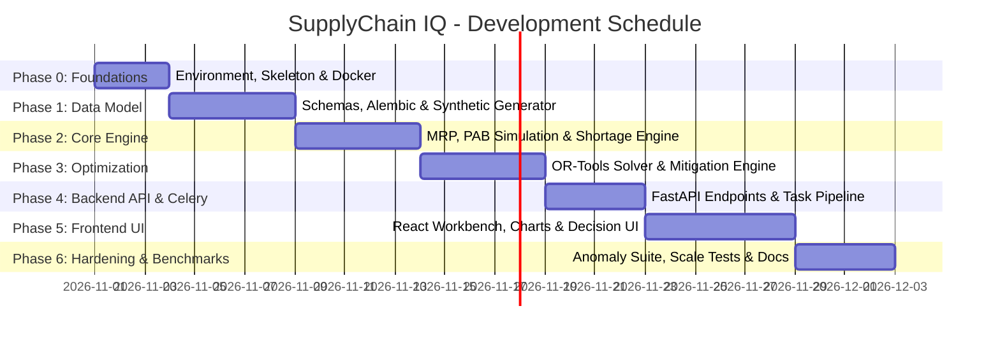

# SupplyChain IQ - Development Roadmap

## 1. Roadmap Principles & Development Philosophy
To ensure production quality and adhere to the project directives:
- **No monolithic big-bang generation:** Incremental, test-driven phases.
- **Strict Separation of Concerns:** Database schemas and migrations precede logic; core calculation engines precede API endpoints; APIs precede frontend UI.
- **Verification Gates:** Each phase must pass automated test suites and architectural reviews before progressing.

---

## 2. Phased Milestone Plan

---

### Phase 0: Project Setup & Infrastructure Foundations
- [ ] Initialize repository directory structure (`backend/`, `frontend/`, `docs/`, `docker/`).
- [ ] Configure `docker-compose.yml` for PostgreSQL 16, Redis 7, Backend, Worker, and Frontend.
- [ ] Configure Python virtual environment with Poetry / UV, install dependencies (`fastapi`, `sqlalchemy`, `pydantic`, `celery`, `duckdb`, `ortools`, `pytest`).
- [ ] Configure Vite React TypeScript frontend with Tailwind CSS and Lucide icons.
- [ ] Establish pre-commit linting (Ruff for Python, ESLint/Prettier for TypeScript).

### Phase 1: Data Modeling, Migrations & Synthetic Data Engine
- [ ] Define SQLAlchemy 2.0 ORM models for all 20 business entities across `public` and `ground_truth` schemas.
- [ ] Author baseline Alembic migration script establishing relational constraints, foreign keys, indexes, and write-once triggers.
- [ ] Build the **Synthetic Data Generator** (`generator.py`):
  - Fixed seed `20261022`.
  - Configurable scales: Starter (100 SKUs, 5 Locs, 12 Wks), Medium (500 SKUs, 15 Locs, 26 Wks), Full (3,000 SKUs, 50 Locs, 52 Wks, 500 Suppliers, 10,000 POs).
  - Inject 5 deliberate anomalies into the dataset.
  - Generate isolated ground-truth labels and populate the `ground_truth` schema.
- [ ] Write unit tests for data generator reproducibility (seed verification) and foreign key integrity.

### Phase 2: Core Supply Chain Calculation Engine
- [ ] Implement multi-level BOM explosion engine (recursive tree traversal and lead-time offset calculation).
- [ ] Implement high-performance Time-Phased Projected Available Balance (PAB) simulation using DuckDB/NumPy.
- [ ] Implement Net Requirements and Shortage Detection module (Hard Stockout vs. Safety Stock breach).
- [ ] Implement deterministic Shortage Priority Scoring algorithm ($0-100$).
- [ ] Implement Anomaly Detection Scanner validating the 5 deliberate data anomalies.
- [ ] Write comprehensive unit tests for PAB mathematics, BOM explosion correctness, and scoring edge-cases.

### Phase 3: Mitigation Engine & Optimization Solver
- [ ] Formulate Mixed-Integer Linear Programming (MILP) model using Google OR-Tools.
- [ ] Implement mitigation levers:
  - Supplier Expedite (PO acceleration).
  - Alternate Sourcing (secondary supplier capacity matching).
  - SKU Substitution (component compatibility & BOM conversion).
  - Inter-Facility Transfer (surplus-to-deficit rebalancing).
  - Production Rescheduling (work center finite capacity balancing).
- [ ] Implement Cost vs. Service multi-criteria trade-off evaluation.
- [ ] Unit test optimization solver under tight capacity, zero capacity, and multi-option trade-offs.

### Phase 4: Backend REST APIs & Celery Planning Pipeline
- [ ] Develop async FastAPI routers:
  - `/api/v1/planning-runs`: Trigger new run, get run status, get run history.
  - `/api/v1/shortages`: Query shortages with filtering, sorting, pagination, and priority rankings.
  - `/api/v1/mitigations`: Fetch recommended options for a shortage.
  - `/api/v1/decisions`: Submit planner approval/rejection/override.
  - `/api/v1/anomalies`: Run integrity scans and fetch detected anomalies.
  - `/api/v1/audit-events`: Query immutable audit trail.
- [ ] Configure Celery workers for async task execution, progress tracking, and error handling.
- [ ] Implement strict transactional auditing: every state change triggers an `AuditEvent`.

### Phase 5: Modern Interactive Frontend (React + TypeScript)
- [ ] Design and implement enterprise navigation, layouts, and theme.
- [ ] **Executive Dashboard:** Macro KPI tiles (Active Shortages, Revenue at Risk, Pending Approvals, OTIF forecast).
- [ ] **Shortage Workbench:** Rich data table with multi-column filtering, priority badges, and search.
- [ ] **PAB Timeline Viewer:** Interactive Recharts line chart showing PAB trajectory, safety stock threshold, demand bars, and PO receipts over time.
- [ ] **Mitigation Decision Matrix:** Modal / Drawer comparing proposed levers with cost, service level, and lead time trade-offs, featuring 1-click Approve/Reject actions.
- [ ] **Data Quality & Anomaly Center:** Dashboard displaying detected anomalies with direct link to offending records.
- [ ] **Audit Trail Viewer:** Read-only chronological event log showing planner actions.

### Phase 6: System Verification, Benchmarking & Documentation
- [ ] Execute full test suite (Pytest backend unit/integration tests; Vitest/React Testing Library for frontend).
- [ ] Benchmark execution speed across Starter, Medium, and Full scales.
- [ ] Verify ground-truth accuracy and anomaly recall against `ground_truth` schema.
- [ ] Finalize Docker Compose deployment documentation and verify fresh-environment setup.

