# SupplyChain IQ - Entity-Relationship (ER) Architecture

## 1. High-Level Entity Relationship Diagram

```mermaid
erDiagram
    SKU ||--o{ SupplierSKU : "catalog entry"
    SUPPLIER ||--o{ SupplierSKU : "supplies"
    SKU ||--o{ Inventory : "stocked in"
    LOCATION ||--o{ Inventory : "holds"
    SKU ||--o{ InventoryTransaction : "transacted"
    LOCATION ||--o{ InventoryTransaction : "logged at"
    SKU ||--o{ ForecastDemand : "demanded"
    LOCATION ||--o{ ForecastDemand : "forecasted at"
    SKU ||--o{ BOM : "parent product"
    BOM ||--o{ BOMComponent : "contains"
    SKU ||--o{ BOMComponent : "consumed as component"
    SKU ||--o{ SubstituteSKU : "primary item"
    SKU ||--o{ SubstituteSKU : "substitute item"
    SKU ||--o{ ProductionPlan : "planned manufacturing"
    LOCATION ||--o{ ProductionPlan : "work center site"
    SUPPLIER ||--o{ SupplierCapacity : "capacity limit"
    SKU ||--o{ SupplierCapacity : "capacity for SKU"
    SUPPLIER ||--o{ PurchaseOrder : "issued to"
    PurchaseOrder ||--o{ PurchaseOrderLine : "contains line"
    SKU ||--o{ PurchaseOrderLine : "ordered material"
    LOCATION ||--o{ PurchaseOrderLine : "delivery destination"
    PurchaseOrder ||--o{ Shipment : "consignment for"
    LOCATION ||--o{ Shipment : "origin / destination"
    LOCATION ||--o{ LeadTime : "origin / destination"
    PlanningRun ||--o{ Shortage : "detects"
    SKU ||--o{ Shortage : "stockout item"
    LOCATION ||--o{ Shortage : "stockout location"
    Shortage ||--o{ MitigationOption : "mitigated by"
    MitigationOption ||--o{ MitigationDecision : "decided by"
    AuditEvent }|--|| PlanningRun : "audits"

    SKU {
        uuid id PK
        string business_id UK
        string sku_code UK
        string name
        string category
        string sku_type
        string unit_of_measure
        decimal unit_cost
        decimal unit_price
        decimal weight_kg
        boolean is_active
        timestamp created_at
        timestamp updated_at
    }

    LOCATION {
        uuid id PK
        string business_id UK
        string location_code UK
        string name
        string location_type
        integer capacity_units
        string country
        boolean is_active
        timestamp created_at
        timestamp updated_at
    }

    SUPPLIER {
        uuid id PK
        string business_id UK
        string supplier_code UK
        string name
        string tier
        string country
        string payment_terms
        decimal on_time_delivery_rate
        boolean is_active
        timestamp created_at
        timestamp updated_at
    }

    SupplierSKU {
        uuid id PK
        string business_id UK
        uuid supplier_id FK
        uuid sku_id FK
        decimal unit_price
        integer moq
        integer pack_size
        integer lead_time_days
        boolean is_preferred
        timestamp effective_from
        timestamp effective_to
    }

    LeadTime {
        uuid id PK
        string business_id UK
        uuid origin_location_id FK
        uuid destination_location_id FK
        string transport_mode
        integer transit_days
        integer variability_days
        decimal cost_per_unit
        timestamp effective_from
        timestamp effective_to
    }

    Inventory {
        uuid id PK
        string business_id UK
        uuid sku_id FK
        uuid location_id FK
        integer on_hand_qty
        integer allocated_qty
        integer safety_stock_qty
        integer reorder_point
        timestamp last_counted_at
    }

    InventoryTransaction {
        uuid id PK
        string business_id UK
        uuid sku_id FK
        uuid location_id FK
        string transaction_type
        integer quantity
        integer balance_after
        string reference_id
        timestamp created_at
    }

    ForecastDemand {
        uuid id PK
        string business_id UK
        uuid sku_id FK
        uuid location_id FK
        string week_bucket
        integer forecast_qty
        integer confidence_p50
        integer confidence_p90
        string version
    }

    BOM {
        uuid id PK
        string business_id UK
        uuid parent_sku_id FK
        string bom_version
        timestamp effective_from
        timestamp effective_to
        boolean is_active
    }

    BOMComponent {
        uuid id PK
        string business_id UK
        uuid bom_id FK
        uuid component_sku_id FK
        decimal quantity_per_parent
        decimal scrap_percentage
        integer lead_time_offset_days
    }

    SubstituteSKU {
        uuid id PK
        string business_id UK
        uuid primary_sku_id FK
        uuid substitute_sku_id FK
        decimal conversion_factor
        integer preference_rank
        boolean is_bidirectional
        timestamp effective_from
        timestamp effective_to
    }

    ProductionPlan {
        uuid id PK
        string business_id UK
        uuid sku_id FK
        uuid location_id FK
        string week_bucket
        integer planned_quantity
        string status
        string work_center_id
    }

    SupplierCapacity {
        uuid id PK
        string business_id UK
        uuid supplier_id FK
        uuid sku_id FK
        string week_bucket
        integer max_capacity_units
        integer committed_units
        integer surge_capacity_units
    }

    PurchaseOrder {
        uuid id PK
        string business_id UK
        string po_number UK
        uuid supplier_id FK
        string status
        timestamp order_date
        decimal total_amount
    }

    PurchaseOrderLine {
        uuid id PK
        string business_id UK
        uuid po_id FK
        integer line_number
        uuid sku_id FK
        uuid destination_location_id FK
        integer ordered_qty
        integer received_qty
        decimal unit_cost
        timestamp promised_delivery_date
    }

    Shipment {
        uuid id PK
        string business_id UK
        uuid po_id FK
        string carrier_code
        string tracking_number UK
        string status
        uuid origin_location_id FK
        uuid destination_location_id FK
        timestamp etd
        timestamp eta
        timestamp actual_delivery_date
    }

    PlanningRun {
        uuid id PK
        string business_id UK
        integer run_number UK
        string status
        integer horizon_weeks
        timestamp started_at
        timestamp completed_at
        boolean is_superseded
    }

    Shortage {
        uuid id PK
        string business_id UK
        uuid planning_run_id FK
        uuid sku_id FK
        uuid location_id FK
        string week_bucket
        integer projected_deficit_qty
        string severity
        decimal priority_score
        string status
    }

    MitigationOption {
        uuid id PK
        string business_id UK
        uuid shortage_id FK
        string action_type
        string status
        integer recommended_qty
        decimal incremental_cost
        decimal service_gain_score
        decimal roi_ratio
        integer rank
    }

    MitigationDecision {
        uuid id PK
        string business_id UK
        uuid mitigation_option_id FK
        string planner_id
        string decision
        integer override_qty
        string reason
        timestamp decided_at
    }

    AuditEvent {
        uuid id PK
        string business_id UK
        string entity_name
        string entity_id
        string action
        string performed_by
        timestamp created_at
    }
```

---

## 2. Structural Relationships & Integrity Rules

1. **Bridge Tables with Temporal Validity:**
   - `SupplierSKU`: Connects `Supplier` and `SKU` with `effective_from` and `effective_to` date ranges, preventing pricing overwrites.
   - `LeadTime`: Connects origin `Location` and destination `Location` with temporal rates and transit durations.
   - `SubstituteSKU`: Connects two `SKU` items (primary and substitute) with preference ranking and conversion factors.
   - `BOMComponent`: Connects `BOM` and component `SKU` with quantity multipliers, scrap factors, and lead-time offsets.

2. **Foreign Key Action Policies:**
   - `CASCADE` deletions on child line items (`PurchaseOrderLine`, `BOMComponent`, `MitigationOption`) when parent entity is deleted.
   - `RESTRICT` deletions on master records (`SKU`, `Location`, `Supplier`) if referenced in inventory, orders, transactions, or production plans.

3. **Deterministic Business Identifiers:**
   - Every entity maintains both a native surrogate `id` (`UUID`) for relational joins and an immutable `business_id` (e.g. `SKU-000001`, `PO-2026-000001`) for user-facing API queries and audit logging.

