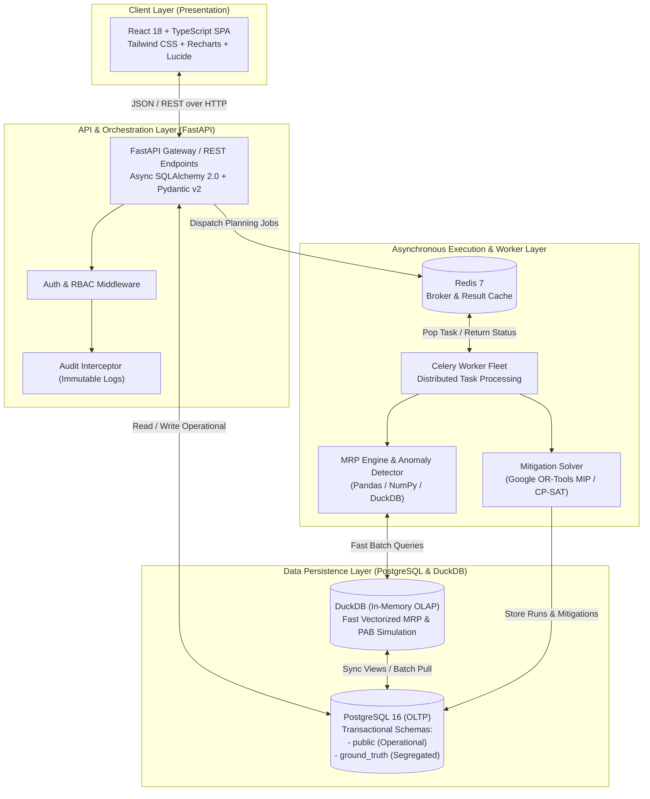
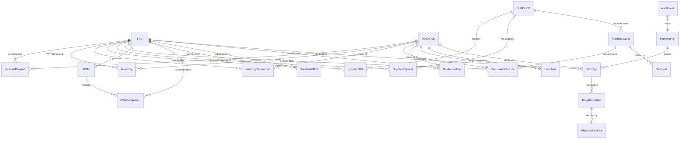
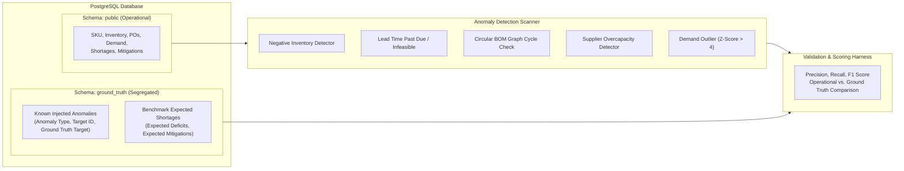

# SupplyChain IQ - System Architecture Document

## 1. High-Level Architectural Overview

SupplyChain IQ is built as an enterprise, event-driven, decoupled micro-modular architecture. It separates online transactional operations (OLTP), analytical and time-series inventory simulations (OLAP), asynchronous combinatorial optimization (OR-Tools MIP solver), and an interactive single-page application (SPA).

---

## 2. Core Architectural Components

### 2.1 Frontend (React, TypeScript, Tailwind CSS, Recharts)
- **Role:** Planner workbench, interactive supply chain digital twin, multi-echelon timeline viewer, mitigation decision matrix.
- **State Management:** TanStack Query (React Query) for server-state caching, optimistic updates, and cache invalidation; Zustand for active planning filters and scenario selections.
- **Visualizations:** Recharts for Projected Available Balance (PAB) vs. Safety Stock trajectory, capacity utilization heatmaps, and cost-vs-service Pareto frontiers.

### 2.2 Backend API (FastAPI, Pydantic v2, SQLAlchemy 2.0)
- **Role:** High-throughput async REST endpoints, request validation, business rule enforcement, transaction orchestration.
- **Design:** Clean Architecture pattern:
  - `routers/`: REST endpoints grouped by domain (inventory, shortages, mitigations, planning runs, audit).
  - `services/`: Domain business logic and orchestration.
  - `repositories/`: Database abstraction with SQLAlchemy 2.0.
  - `schemas/`: Pydantic input/output schemas with strict type validation.
  - `models/`: SQLAlchemy ORM entity definitions.

### 2.3 Optimization Engine (Google OR-Tools)
- **Role:** Multi-objective Mixed-Integer Programming (MIP) and Constraint Programming (CP-SAT) solver for shortage mitigation.
- **Objectives:**
  1. Minimize total incremental mitigation cost (expedite fee + transport variance + supplier surcharge + substitution loss).
  2. Maximize preserved revenue and order fulfillment service levels.
- **Constraints:** Supplier capacity limits per week, shipment transit lead times, bill-of-materials conversion factors, finite factory line capacity.

### 2.4 Data Processing Engine (DuckDB, Pandas, NumPy)
- **Role:** High-performance in-memory simulation for time-phased MRP gross-to-net calculations across large datasets (Full scale: 3,000 SKUs $\times$ 50 Locations $\times$ 52 Weeks = 7.8M time buckets).
- DuckDB executes window functions and multi-table joins in milliseconds, avoiding row-by-row ORM overhead for batch simulations.

### 2.5 Message Broker & Task Queue (Celery + Redis)
- **Role:** Asynchronous processing of long-running planning runs, synthetic data generation, and anomaly detection sweeps.
- Decouples client HTTP requests from compute-intensive MRP runs, providing real-time progress tracking (`PENDING` $\rightarrow$ `RUNNING` $\rightarrow$ `COMPLETED`).

---

## 3. Entity-Relationship (ER) Architecture

The schema contains 20 core business entities organized into functional groups.

---

## 4. Immutability Strategy

In enterprise supply chain planning, historical auditability is non-negotiable.

1. **Planning Runs are Append-Only:**
   - Every execution creates a unique `PlanningRun` with a UUID and sequential `run_number`.
   - Results (`Shortage`, `MitigationOption`) reference `planning_run_id`.
   - Running the engine again creates a fresh `PlanningRun`; previous runs are marked `is_superseded = TRUE` but never updated or deleted.
2. **Planner Decisions & Overrides:**
   - When a planner approves or rejects an option, a new `MitigationDecision` record is inserted with the user timestamp, justification, and state change.
   - An immutable `AuditEvent` is captured synchronously within the same database transaction.
3. **Database Level Controls:**
   - Write-once audit tables configured with database triggers preventing `UPDATE` or `DELETE` operations on `audit_events` and `planning_runs`.

---

## 5. Ground-Truth Data Isolation & Anomaly Detection Architecture

- **Segregation:** The `ground_truth` schema is isolated from application APIs. The operational planning engine has zero access to `ground_truth` tables.
- **Verification Harness:** An offline evaluation module compares detected anomalies and shortage calculations against `ground_truth` to compute precision, recall, and benchmark accuracy.

