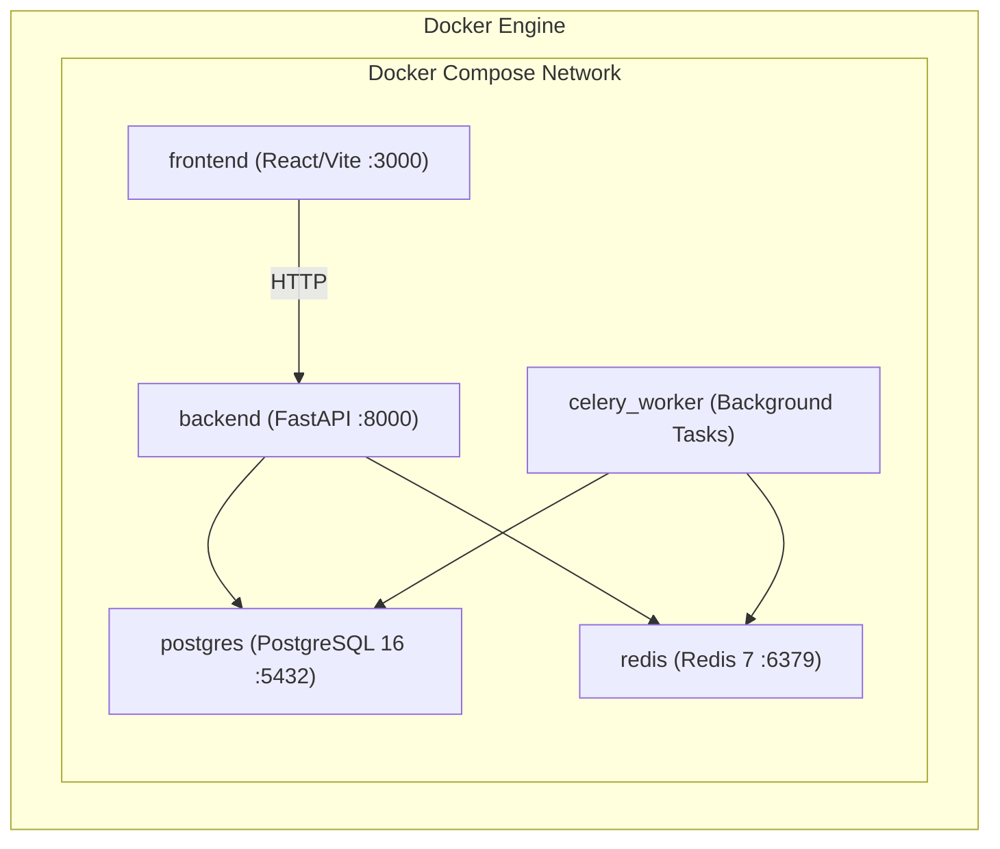

# SupplyChain IQ - Technical Stack Specification

## 1. Complete Technology Matrix

| Layer | Technology | Version | Primary Purpose | Key Libraries & Ecosystem |
|---|---|---|---|---|
| **Frontend UI** | React | `^18.3.1` | Reactive Planner Web Application | TypeScript, Vite, Tailwind CSS, Lucide React |
| **Data Viz & Charts** | Recharts | `^2.12.7` | Time-Phased PAB curves, Shortage Pareto, Trade-off Charts | ResponsiveContainer, LineChart, BarChart, ScatterPlot |
| **State & API Client** | TanStack Query | `^5.51.0` | Server-state caching, optimistic updates, pagination | Axios, Zustand (for UI scenario state) |
| **Backend Framework**| FastAPI | `^0.111.0` | High-performance asynchronous REST API | Starlette, Uvicorn (ASGI server) |
| **Data Validation** | Pydantic | `^2.8.0` | Request/Response schema validation & serialization | Pydantic-Settings |
| **ORM & DB Access** | SQLAlchemy | `^2.0.31` | Relational ORM & typed SQL queries | asyncpg (async PostgreSQL driver), psycopg2-binary |
| **DB Migrations** | Alembic | `^1.13.2` | Version-controlled, schema migrations | Python migration scripts |
| **Transactional DB** | PostgreSQL | `16-alpine` | ACID relational persistence & audit history | Segregated schemas: `public`, `ground_truth` |
| **Analytical DB** | DuckDB | `^1.0.0` | In-memory vectorized MRP calculation & batch processing | Arrow integration, DuckDB-Python |
| **Data Engineering** | Pandas / NumPy | `^2.2.0` / `^1.26.0` | Vectorized matrix operations & synthetic data generation | Fast time-series rolling calculations |
| **Optimization** | Google OR-Tools | `^9.10.0` | Multi-objective MILP solver for mitigation recommendations | `pywraplp` (Linear Solver), CP-SAT |
| **Task Queue** | Celery | `^5.4.0` | Distributed asynchronous planning job orchestration | Celery Beat, Kombu |
| **Message Broker** | Redis | `7-alpine` | In-memory message broker, task state & cache store | redis-py |
| **Testing** | Pytest | `^8.2.0` | Unit, integration, and property-based test suites | pytest-asyncio, pytest-cov, factory-boy |
| **Containerization**| Docker & Compose | Compose v2 | Multi-container reproducible local & production runtime | Multi-stage Dockerfiles |

---

## 2. Component Justification & Architecture Decisions

### 2.1 Backend: FastAPI + SQLAlchemy 2.0 (Async) + Pydantic v2
- **Why FastAPI & Pydantic v2:** Pydantic v2's Rust-based core provides lightning-fast serialization and deserialization for large supply chain payloads (e.g. 52-week time-series vectors). FastAPI provides automatic OpenAPI documentation, dependency injection, and native asynchronous I/O.
- **Why SQLAlchemy 2.0:** Full typing support, explicit transaction management, separation of queries from model instances, and complete support for both async operations (API layer) and sync bulk operations (background worker layer).

### 2.2 Analytical Processing: DuckDB + NumPy / Pandas
- **Why DuckDB:** PostgreSQL is optimal for transactional mutations (orders, decisions, audit logs). However, executing multi-echelon MRP simulations across 3,000 SKUs $\times$ 50 Locations $\times$ 52 Weeks (over 7.8 million time-series data points) in traditional row-by-row ORM queries incurs prohibitive latency. DuckDB provides vectorized columnar execution directly in-process with zero network overhead, reading directly from Parquet or PostgreSQL buffers in sub-second times.

### 2.3 Optimization Solver: Google OR-Tools
- **Why OR-Tools:** Supply chain mitigation is a constrained optimization problem:
  - Binary decision variables for supplier selection and expediting.
  - Linear inequalities for supplier weekly capacity, MOQ, and transit times.
  - Multi-objective scalarization balancing incremental mitigation cost against service level risk.
  - Google OR-Tools provides world-class open-source Mixed-Integer Linear Programming (MILP) using SCIP and CBC solvers without requiring expensive commercial licenses (Gurobi/CPLEX).

### 2.4 Asynchronous Processing: Celery + Redis
- Planning runs can span several seconds or minutes for full-scale datasets. Using Celery ensures HTTP request timeouts never occur; clients receive a `run_id` instantly, and the UI subscribes via polling or WebSockets to track live progress bars.

### 2.5 Frontend: React + TypeScript + Tailwind CSS + Recharts
- **TypeScript:** Enforces strict contract alignment with Pydantic backend models.
- **Tailwind CSS:** Enables a dense, professional, enterprise-grade data workbench interface (high-density tables, status badges, metric KPI cards).
- **Recharts:** Composable SVG charts tailored for inventory balance time-series, cumulative deficit bands, and cost-benefit trade-off scatter plots.

---

## 3. Environment & Configuration Management

Configuration is strictly loaded from environment variables using `pydantic-settings`:

```ini
# Application Configuration
APP_ENV=development
APP_DEBUG=true
API_V1_STR=/api/v1
SECRET_KEY=generate-strong-key-for-production
ALGORITHM=HS256
ACCESS_TOKEN_EXPIRE_MINUTES=480

# Database Configuration (PostgreSQL)
POSTGRES_SERVER=localhost
POSTGRES_PORT=5432
POSTGRES_DB=supplychain_iq
POSTGRES_USER=postgres
POSTGRES_PASSWORD=postgres_secure_pass

# Redis & Celery
REDIS_HOST=localhost
REDIS_PORT=6379
REDIS_DB=0
CELERY_BROKER_URL=redis://localhost:6379/0
CELERY_RESULT_BACKEND=redis://localhost:6379/1

# Planning Engine Settings
DEFAULT_HORIZON_WEEKS=26
SYNTHETIC_DATA_RANDOM_SEED=20261022
OR_TOOLS_TIME_LIMIT_SECONDS=30
```

---

## 4. Containerized Multi-Service Architecture (Docker Compose)



- Each container has health-checks configured.
- Database volumes persist data across container recreation.
- Independent worker scaling (`docker-compose up --scale celery_worker=3`).

